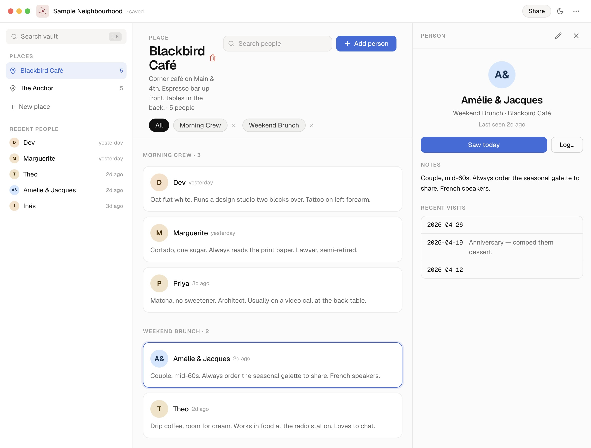

<p align="center">
  
</p>

<h1 align="center">MyRegulars</h1>

<p align="center">
  A personal notebook for remembering the names and faces of regulars at your favourite local spots.
</p>

<p align="center">
  
</p>

---

## What it does

MyRegulars helps you track the people you see regularly at cafes, gyms, co-working spaces, or any venue you frequent. Never forget a name again.

- **Vaults** — Each vault is a self-contained notebook backed by a GitHub Gist. Create as many as you like, share them read-only, or clone someone else's.
- **Places** — Organize people by location (e.g. "Morning Cafe", "Friday Gym").
- **Groups** — Within a place, split people into groups (e.g. "Staff", "Regulars", "Dog walkers").
- **People** — Record names, key details, photos, pets, and visit history for each person.
- **Visit logging** — One-tap "seen today" tracking with optional notes.
- **Version history** — Every save is versioned. Browse, view, or revert to any past state of your vault.
- **Sharing** — Generate a QR code or share link so others can view (read-only) or clone your vault.
- **Offline-friendly** — Cached locally for fast loads; syncs to GitHub Gists when online.
- **Dark mode** — Full light/dark theme support.
- **Responsive** — Mobile-first design with a desktop sidebar layout.

## Tech stack

| Layer      | Technology                           |
| ---------- | ------------------------------------ |
| Framework  | Next.js (App Router)                 |
| Language   | TypeScript (strict)                  |
| Styling    | Tailwind CSS                         |
| Data store | GitHub Gists (one gist = one vault)  |
| Validation | Zod                                  |
| Auth       | GitHub OAuth (personal access token) |
| Testing    | Vitest + React Testing Library       |
| E2E        | Playwright                           |

## Getting started

```bash
# Install dependencies
npm install

# Run the dev server
npm run dev
```

Open [http://localhost:3000](http://localhost:3000) and sign in with your GitHub account.

## Scripts

| Command                       | Purpose                                        |
| ----------------------------- | ---------------------------------------------- |
| `npm run dev`                 | Start development server                       |
| `npm run build`               | Production build                               |
| `npm run format-and-validate` | Format, typecheck, lint, and test in one pass  |
| `npm test`                    | Run unit/component tests (Vitest)              |
| `npm run test:e2e`            | Run end-to-end tests (Playwright)              |
| `npm run cf:preview`          | Build and run the Cloudflare Worker locally    |
| `npm run cf:deploy`           | Build and deploy the Cloudflare Worker         |
| `npm run pb:deploy`           | Push PocketBase migrations/hooks to PocketHost |

## Deployment

The app ships as a **Cloudflare Worker with static assets**, built by
[`@opennextjs/cloudflare`](https://opennext.js.org/cloudflare). The hosted vault backend is a
PocketBase instance on PocketHost (see `pocketbase/README.md`).

| Command              | What it does                                                        |
| -------------------- | ------------------------------------------------------------------- |
| `npm run cf:build`   | `next build` + adapt to a Worker under `.open-next/`                |
| `npm run cf:preview` | Build, then serve the Worker locally with `wrangler dev`            |
| `npm run cf:deploy`  | Build and deploy with the Cloudflare credentials in your shell      |
| `npm run cf:typegen` | Regenerate `cloudflare-env.d.ts` from `wrangler.jsonc` (gitignored) |

**Automatic deploys.** `.github/workflows/deploy.yml` deploys `main` on every push. It needs, on
the repository's `production` environment:

- secrets `CLOUDFLARE_API_TOKEN` (Workers Scripts: Edit) and `CLOUDFLARE_ACCOUNT_ID`. The same two
  in `.env.local` let `npm run cf:deploy` work from your machine, since wrangler reads `.env*`;
- secrets `GIST_OAUTH_CLIENT_ID` / `GIST_OAUTH_CLIENT_SECRET`: the values of `GITHUB_OAUTH_*` from
  `.env.local` (GitHub refuses secret names that start with `GITHUB_`). The workflow pushes them to
  the Worker as `GITHUB_OAUTH_*` runtime secrets on each deploy;
- secrets `PB_SUPERUSER_EMAIL` / `PB_SUPERUSER_PASSWORD`: your PocketHost login, used by the
  PocketBase deploy workflow below;
- variable `NEXT_PUBLIC_POCKETBASE_URL` (inlined into the client bundle at build time).

`scripts/github-secrets.sh` creates the `production` environment and sets all of the above from
your `.env.local` with the `gh` CLI.

**PocketBase (PocketHost).** `.github/workflows/deploy-pocketbase.yml` pushes
`pocketbase/pb_migrations` and `pb_hooks` to the instance named in the committed `.phioconfig`
whenever they change on `main`, using [phio](https://pockethost.io/blog/phio-sftp-deploy),
PocketHost's SFTP deploy CLI, signed in with the `PB_SUPERUSER_*` secrets. From your machine
`npm run pb:deploy` does the same, reading the pair from `.env.local`. Hooks reload live; **migrations run on the instance's next start**, so
power-cycle it from the PocketHost dashboard after a migration ships. See `pocketbase/README.md`.

**Local preview.** Put the two `GITHUB_OAUTH_*` values in `.dev.vars` (gitignored) and run
`npm run cf:preview`; the Worker serves on `http://localhost:8787`. The GitHub OAuth app's callback
URL must match the origin you are testing (`<origin>/api/auth/github/callback`), so production
uses its own OAuth app pointed at the Worker's domain.

**Custom domain.** Attach `myregulars.app` to the Worker as a custom domain in the Cloudflare
dashboard once its DNS is on Cloudflare; until then the `*.workers.dev` URL is the app's origin and
must be the one registered on the GitHub OAuth app.

## Project structure

```
src/
  app/              # Next.js App Router pages and API routes
  components/       # React components (UI primitives + features)
  lib/              # Core logic — datastore adapters, context, utilities
    datastore/      # Pluggable storage layer (GitHub Gist adapter)
docs/               # Design assets and reference material
e2e/                # Playwright end-to-end tests
```

## License

Private project.
